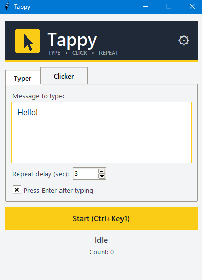
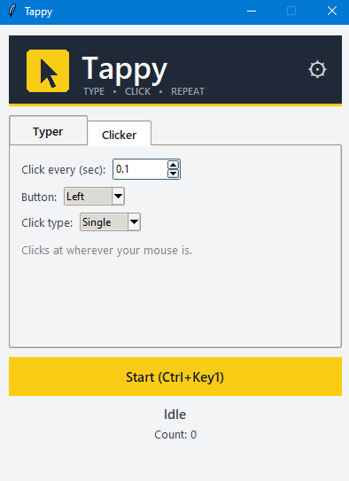

# Tappy

**Type. Click. Repeat.**

Tappy is a small Windows tool that does two jobs in one window:

- **Typer:** types a message for you, presses Enter, waits, and repeats.
- **Clicker:** clicks your mouse on a timer.

Start and stop with one hotkey (F6 by default).

## Download

[Download Tappy.zip](https://github.com/tappyclick/tappy/raw/main/Tappy.zip), unzip it, and open `Tappy.exe`. You don't need Python or anything else installed.

> **Windows may show "Windows protected your PC".**
> Tappy sends fake keyboard and mouse input, so Windows SmartScreen and some antivirus tools flag it by mistake. Click **More info**, then **Run anyway**. Tappy only types and clicks. Nothing else runs.

## How to use it

1. Open Tappy and pick the **Typer** or **Clicker** tab.
2. Set it up (see below).
3. Press **F6** or click the **Start** button.
4. You get a **3 second countdown**. Click into the window you want to type or click in.
5. Press **F6** again to stop.

Switching tabs stops whatever is running.

### Typer

- Type your message in the box.
- **Repeat delay:** seconds to wait between messages (as low as 0.1).
- **Press Enter after typing:** tick this to send the message each time.

### Clicker

- **Click every (sec):** how often to click (as low as 0.01).
- **Button:** left, right or middle.
- **Click type:** single or double.
- It clicks wherever your mouse is, so move it onto your target during the countdown.

### Change the hotkey

1. Click the gear icon in the top right.
2. Click **Change**, then press your new hotkey.
3. Click **Done**.

Use an F-key (like F8) or add Ctrl, Alt or Shift (like Ctrl+Shift+S). Plain letters aren't allowed because they would trigger while you type. Press Esc to cancel, or **Reset to F6** to go back to the default. Your choice is saved for next time.

## Good to know

- **Windows only.**
- **Online games:** many ban auto clickers and auto typers. Use Tappy at your own risk, and only where it is allowed.
- **Settings file:** your hotkey is saved in `.tappy_settings.json` in your user folder.

## Support Tappy

Tappy is free. If it saved you some time, you can [buy me a coffee on Ko-fi](https://ko-fi.com/tappyclick).

## License

Copyright (c) 2026. All rights reserved. You may download and use Tappy for personal use. You may not copy, modify, redistribute or resell it.
